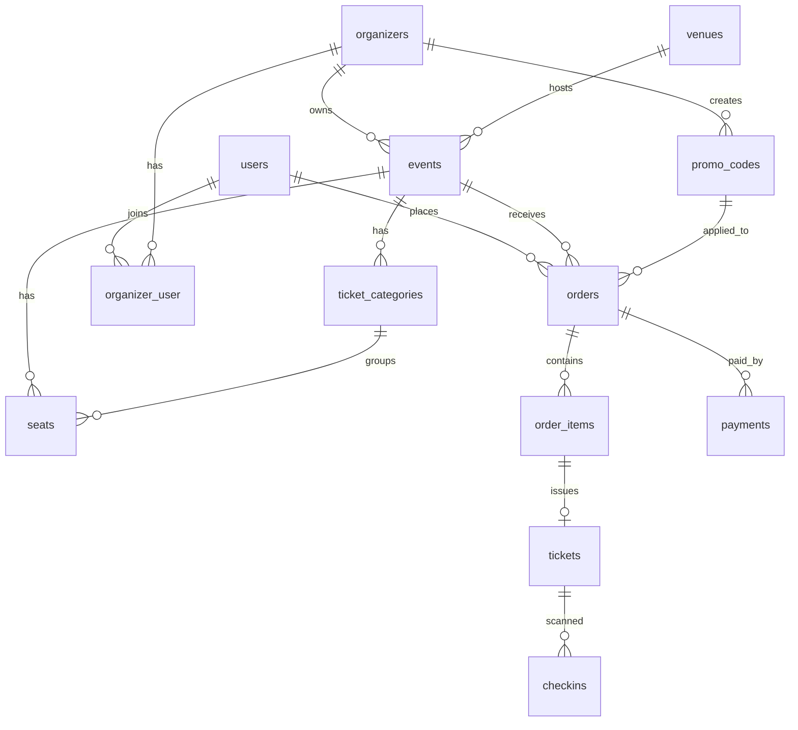

# Skema Database — TiketKu (draft awal)

Konvensi: `id` bigint unsigned PK, `created_at`/`updated_at` di semua tabel,
uang = integer Rupiah, status = string (cast ke enum di model).
Role/permission memakai tabel bawaan `spatie/laravel-permission`,
log aktivitas memakai `spatie/laravel-activitylog`.

## Diagram relasi

## Tabel

### users
`name`, `email` (unique), `phone` nullable, `password`, `email_verified_at`, `remember_token`

### organizers
`owner_id` -> users, `name`, `slug` (unique), `description` nullable, `logo_path` nullable,
`status` (pending|verified|suspended), `commission_rate` decimal(5,2) default 5.00

### organizer_user (anggota/panitia)
`organizer_id`, `user_id`, `role` (owner|manager|gate_staff) — unique (`organizer_id`, `user_id`)

### venues
`name`, `city`, `address`, `latitude` nullable, `longitude` nullable, `capacity` nullable

### events
`organizer_id`, `venue_id`, `title`, `slug` (unique), `description`, `category`,
`banner_path` nullable, `starts_at`, `ends_at`, `sales_start_at`, `sales_end_at`,
`status` (draft|published|finished|cancelled), `has_seating` bool default false,
`max_tickets_per_order` tinyint default 6, `deleted_at`
Index: (`status`, `starts_at`), (`venue_id`)

### ticket_categories
`event_id`, `name`, `description` nullable, `price` unsigned int, `quota` unsigned int,
`sold_count` unsigned int default 0, `sales_start_at` nullable, `sales_end_at` nullable, `sort_order`
Catatan: stok tersisa = `quota - sold_count - (jumlah reservasi aktif)`; update di dalam transaction + lock.

### seats (hanya untuk event `has_seating`)
`event_id`, `ticket_category_id`, `section`, `row_label`, `seat_number`,
`status` (available|held|sold) default available, `held_by_user_id` nullable,
`held_until` nullable, `pos_x` nullable, `pos_y` nullable
Unique: (`event_id`, `section`, `row_label`, `seat_number`)
Index: (`event_id`, `status`)

### promo_codes
`organizer_id`, `event_id` nullable, `code`, `type` (percent|fixed), `value`,
`min_purchase` nullable, `max_uses` nullable, `used_count` default 0, `starts_at` nullable, `expires_at` nullable
Unique: (`organizer_id`, `code`)

### orders
`code` (unique, mis. TKU-XXXXXXXX), `user_id`, `event_id`, `promo_code_id` nullable,
`status` (pending|paid|expired|cancelled|refunded), `subtotal`, `discount` default 0,
`fee` default 0, `total`, `expires_at`, `paid_at` nullable
Index: (`user_id`, `status`), (`status`, `expires_at`)

### order_items (satu baris per tiket)
`order_id`, `ticket_category_id`, `seat_id` nullable, `unit_price`

### payments
`order_id`, `provider` (midtrans|xendit), `provider_ref` nullable, `method` nullable,
`amount`, `status` (pending|paid|failed|expired|refunded), `payload` json nullable, `paid_at` nullable
Unique: (`provider`, `provider_ref`)

### webhook_events (untuk idempotency)
`provider`, `external_id`, `payload` json, `processed_at` nullable
Unique: (`provider`, `external_id`)

### tickets
`order_item_id` (unique), `event_id`, `ticket_category_id`, `seat_id` nullable,
`holder_name` nullable, `code` (unique), `signature`,
`status` (issued|used|cancelled|refunded), `used_at` nullable
Index: (`event_id`, `status`)

### checkins
`ticket_id` nullable, `scanned_by` -> users, `gate` nullable,
`result` (success|duplicate|invalid|wrong_event), `scanned_code`, `scanned_at`

## Catatan desain
- `tickets.code` dan `signature`: kode acak panjang + HMAC dari (code, event_id), jadi tidak bisa ditebak/dipalsukan.
- Kursi yang `held` kedaluwarsa dilepas oleh scheduled job dan juga dicek saat reservasi (lazy release).
- Reservasi sementara di Redis (TTL) dipakai untuk kecepatan; DB tetap sumber kebenaran.
- Tambahkan index baru hanya setelah ada query nyata yang lambat (cek dengan `EXPLAIN`).
